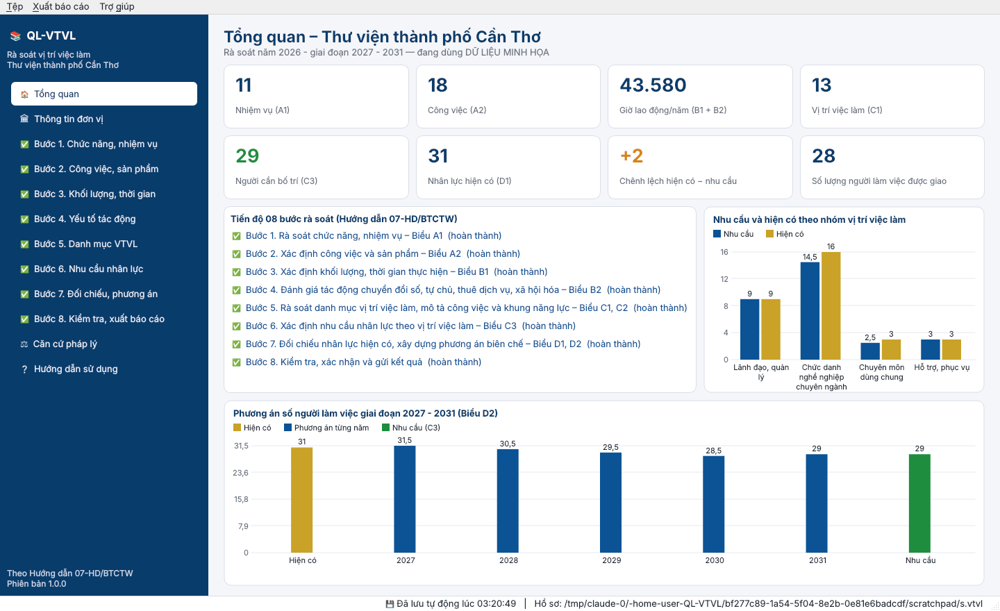
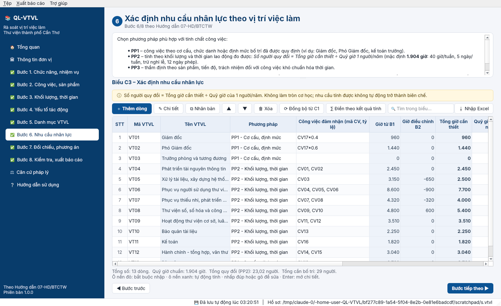
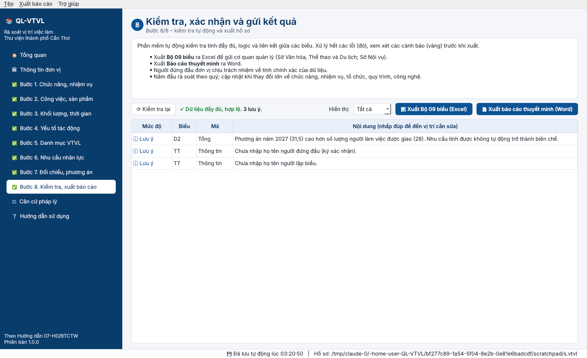

# QL-VTVL – Phần mềm rà soát vị trí việc làm
### Thư viện thành phố Cần Thơ

Phần mềm chạy trên máy tính Windows, hỗ trợ **rà soát, hoàn thiện vị trí việc làm, xác định nhu cầu nhân lực và xây dựng phương án số lượng người làm việc giai đoạn 2027 – 2031**. Phần mềm làm theo **Hướng dẫn số 07-HD/BTCTW ngày 19/10/2026 của Ban Tổ chức Trung ương** (08 bước, 09 biểu nghiệp vụ A1 – D2) và các văn bản mới nhất về vị trí việc làm.



---

## 1. Cài đặt trên Windows

**Yêu cầu:** Windows 10 hoặc 11, 64-bit. Không cần cài Python, không cần Internet, không cần quyền quản trị.

1. Tải tệp **`CaiDat_QL-VTVL_1.0.0.exe`**:
   - từ mục **Releases** của kho mã, hoặc
   - từ mục **Actions → Đóng gói bộ cài Windows →** lần chạy mới nhất **→ Artifacts → `QL-VTVL-Windows`**.
2. Nhấp đúp tệp cài đặt và làm theo hướng dẫn (*Tiếp theo → Cài đặt*). Nếu Windows SmartScreen cảnh báo, chọn **More info → Run anyway** (phần mềm nội bộ, chưa ký số).
3. Mở phần mềm từ biểu tượng **QL-VTVL** trên màn hình nền hoặc menu Start.

> Không muốn cài đặt? Dùng bản **`QL-VTVL_portable.zip`**: giải nén rồi chạy `QL-VTVL.exe`.

## 2. Quy trình 08 bước trong phần mềm

| Bước | Nội dung | Biểu |
|---|---|---|
| 1 | Rà soát chức năng, nhiệm vụ | **A1** – Danh mục nhiệm vụ |
| 2 | Xác định công việc và sản phẩm | **A2** – Công việc và sản phẩm |
| 3 | Xác định khối lượng, thời gian thực hiện | **B1** – Khối lượng và thời gian thực hiện công việc |
| 4 | Đánh giá tác động chuyển đổi số, tự chủ, thuê dịch vụ, xã hội hóa | **B2** – Tác động của chuyển đổi số, tự chủ, thuê dịch vụ và xã hội hóa |
| 5 | Rà soát danh mục vị trí việc làm, mô tả công việc, khung năng lực | **C1** – Danh mục VTVL; **C2** – Bản mô tả công việc và khung năng lực |
| 6 | Xác định nhu cầu nhân lực theo vị trí việc làm (PP1/PP2/PP3) | **C3** – Xác định nhu cầu nhân lực |
| 7 | Đối chiếu nhân lực hiện có, xây dựng phương án | **D1** – Đối chiếu nguồn nhân lực hiện có; **D2** – Phương án biên chế 2027 – 2031 |
| 8 | Kiểm tra, xác nhận và gửi kết quả | Kiểm tra tự động, xuất Excel/Word |

Mỗi bước có **phần hướng dẫn nghiệp vụ** ở trên và **bảng nhập liệu** ở dưới. Thanh bên trái đánh dấu tiến độ từng bước: ⚪ chưa bắt đầu, 🟡 đang thực hiện, ✅ hoàn thành.



### Tính toán tự động
- **B1:** Tổng giờ = Số lượng sản phẩm/năm × Thời gian lao động trực tiếp/1 sản phẩm.
- **C3 (PP2):** Số người quy đổi = (Giờ B1 + Giờ điều chỉnh B2 của các công việc đảm nhận, theo tỷ lệ) ÷ Quỹ giờ 1 người/năm. Quỹ giờ mặc định là **1.904 giờ** (40 giờ/tuần), sửa được ở *Thông tin đơn vị*.
  Ví dụ của Hướng dẫn: 2.600 giờ ÷ 1.904 ≈ **1,366 người**. Phần mềm giữ nguyên số lẻ, **không làm tròn cơ học**.
- **PP1/PP3:** ghi số người theo định mức hoặc thẩm định, kèm giải trình, không gán số giờ giả định.
- **D1:** Tổng hiện có, chênh lệch thừa (+) hoặc thiếu (−) so với nhu cầu.
- **D2:** Nhu cầu và hiện có tự lấy từ C3, D1. Nút *Gợi ý lộ trình* đề xuất mức điều chỉnh dần qua các năm 2027 – 2031.

### Kiểm tra tự động (Bước 8)
Phần mềm phát hiện: thiếu dữ liệu bắt buộc, mã trùng, mã tham chiếu không tồn tại, nhiệm vụ chưa có công việc, công việc chưa có khối lượng hoặc chưa giao cho vị trí nào, công việc giao quá 100%, PP2 không có giờ, PP1/PP3 thiếu giải trình, quỹ giờ đặc thù chưa giải trình, đề xuất cao hơn kết quả tính do làm tròn, chênh lệch thừa/thiếu chưa giải trình, lộ trình vượt nhu cầu… Nhấp đúp vào từng dòng để đến đúng ô cần sửa.



### Xuất hồ sơ
- **Bộ 09 biểu (Excel):** mỗi biểu một trang tính. Có quốc hiệu, tên biểu, dòng "Kèm theo Hướng dẫn 07-HD/BTCTW", dòng tổng cộng và phần ký của người lập biểu và thủ trưởng đơn vị. Kèm trang *Tổng hợp* và trang *Kiểm tra*. Trang in khổ A4 ngang.
- **Báo cáo thuyết minh (Word):** theo thể thức văn bản hành chính, gồm căn cứ, kết quả rà soát, danh mục vị trí việc làm, nhu cầu nhân lực, đối chiếu và phương án, kiến nghị.
- **Nhập từ Excel:** nhập lại toàn bộ hoặc từng biểu từ tệp đã xuất. Có thể chia biểu cho từng phòng điền rồi tổng hợp lại.

## 3. Mẹo sử dụng
- **Ctrl+N** thêm dòng · **Enter** mở cửa sổ chi tiết · **Delete** xóa · nhấp đúp hoặc gõ trực tiếp để sửa ô.
- Ô nền **đỏ nhạt** là bắt buộc nhập. Ô nền **xanh nhạt** do phần mềm tự tính.
- Các cột mã (nhiệm vụ, công việc, vị trí) được chọn từ danh sách. Khi đổi mã ở biểu gốc, các biểu liên quan tự cập nhật.
- Biểu C3: nhấp đúp cột *Công việc đảm nhận* để chọn công việc và tỷ lệ % khi một công việc do nhiều vị trí cùng làm.
- Biểu C2, C3, D1, D2: nút **⟳ Đồng bộ từ C1** tạo sẵn dòng cho mọi vị trí việc làm.
- Dữ liệu **lưu tự động** vào tệp hồ sơ `.vtvl`. Dùng *Tệp → Lưu thành (sao lưu)* để giữ bản sao theo từng đợt rà soát.
- *Tệp → Mở hồ sơ dữ liệu minh họa* mở bộ số liệu mẫu để làm quen. **Đây không phải số liệu chính thức.**

## 4. Căn cứ pháp lý (cập nhật được trong phần mềm)
- Hướng dẫn 07-HD/BTCTW ngày 19/10/2026 và Kế hoạch 71-KH/BTCTW của Ban Tổ chức Trung ương.
- Luật Viên chức số 129/2025/QH15; Luật Cán bộ, công chức số 80/2025/QH15.
- Nghị định 106/2020/NĐ-CP về vị trí việc làm và số lượng người làm việc trong đơn vị sự nghiệp công lập. Văn bản này tiếp tục được áp dụng trong khi chờ Nghị định hướng dẫn Luật Viên chức 2025.
- Quy định 70-QĐ/TW về quản lý biên chế của hệ thống chính trị.
- Luật Thư viện 2019; Thông tư 10/2023/TT-BVHTTDL; Thông tư 02/2022/TT-BVHTTDL; Thông tư 07/2023/TT-BVHTTDL.
- Thông tư 12/2022/TT-BNV; Thông tư 29/2022/TT-BTC; Nghị định 111/2022/NĐ-CP.

> Danh mục và nội dung hướng dẫn được tổng hợp tại thời điểm phát hành. Khi có văn bản mới, cập nhật tại mục **Căn cứ pháp lý** trong phần mềm và đối chiếu văn bản gốc trước khi gửi hồ sơ.

## 5. Dành cho cán bộ kỹ thuật

```bash
pip install -r requirements.txt
python run.py                 # chạy từ mã nguồn
python -m pytest tests        # kiểm thử
```

**Tự đóng gói trên Windows:** cài Python 3.11+ (64-bit) và [Inno Setup 6](https://jrsoftware.org/isinfo.php), rồi chạy `build_windows.bat`. Kết quả nằm ở `dist\installer\`.

**Đóng gói tự động:** mỗi lần đẩy mã lên GitHub, workflow `.github/workflows/build-windows.yml` sẽ kiểm thử, đóng gói, chạy thử bản `.exe` và tạo bộ cài. Gắn tag `v1.0.0` để phát hành chính thức vào mục Releases.

Cấu trúc mã nguồn:
```
qlvtvl/core/forms.py     Đặc tả 09 biểu (cột, kiểu dữ liệu, danh mục lựa chọn)
qlvtvl/core/guide.py     Nội dung hướng dẫn 08 bước, căn cứ pháp lý
qlvtvl/core/calc.py      Công thức tính (B1, C3 – PP1/PP2/PP3, D1, D2)
qlvtvl/core/checks.py    Kiểm tra tự động (Bước 8)
qlvtvl/core/exporter.py  Xuất Excel/Word, nhập Excel
qlvtvl/core/db.py        Lưu trữ SQLite (tệp .vtvl)
qlvtvl/core/seed.py      Dữ liệu minh họa Thư viện TP Cần Thơ
qlvtvl/ui/               Giao diện PySide6 (Qt)
installer/qlvtvl.iss     Kịch bản bộ cài Inno Setup
```
