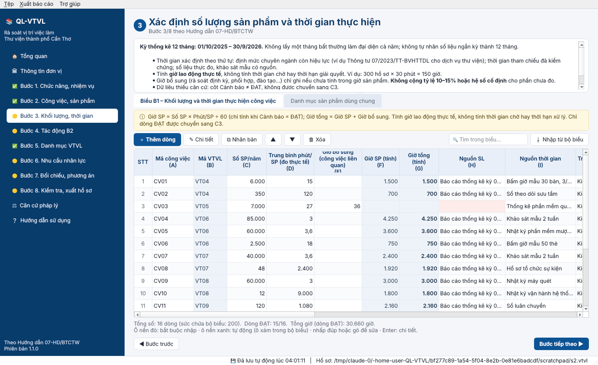

# QL-VTVL – Phần mềm rà soát vị trí việc làm
### Thư viện thành phố Cần Thơ

Phần mềm cài trên Windows, hỗ trợ **rà soát, hoàn thiện vị trí việc làm, xác định nhu cầu nhân lực và xây dựng phương án biên chế giai đoạn 2027 – 2031**. Phần mềm làm theo **Hướng dẫn số 7-HD/BTCTW ngày 19/10/2026 của Ban Tổ chức Trung ương** (thực hiện Kết luận số 107-KL/TW ngày 17/10/2026 của Bộ Chính trị), kèm Bộ phụ lục I–VIII và **Bộ biểu Excel 19-10-2026**.

Phần mềm dùng **đúng tên cột, ký hiệu cột, danh sách lựa chọn, công thức và cảnh báo** của Bộ biểu chính thức. Kết quả tính đã được đối chiếu tự động với chính Bộ biểu trên 1.857 ô công thức: không có sai lệch. Khi xuất, dữ liệu được ghi **thẳng vào file Excel chính thức** để gửi theo đầu mối quy định.


---

## 1. Cài đặt trên Windows

**Yêu cầu:** Windows 10 hoặc 11, 64-bit. Không cần Python, không cần Internet, không cần quyền quản trị.

1. Tải **`CaiDat_QL-VTVL_1.1.0.exe`** tại mục **Actions → Đóng gói bộ cài Windows →** lần chạy mới nhất **→ Artifacts → `QL-VTVL-Windows`** (hoặc tại mục **Releases** nếu đã phát hành).
2. Nhấp đúp tệp cài đặt và làm theo hướng dẫn. Nếu Windows SmartScreen cảnh báo, chọn **More info → Run anyway**: đây là phần mềm nội bộ, chưa ký số.
3. Mở phần mềm từ biểu tượng **QL-VTVL**.

> Bản **`QL-VTVL_portable.zip`** không cần cài: giải nén rồi chạy `QL-VTVL.exe`.

## 2. Quy trình 08 bước (Mục II Hướng dẫn 7-HD/BTCTW)

| Bước | Nội dung | Biểu (trang tính trong Bộ biểu) |
|---|---|---|
| 1 | Rà soát chức năng, nhiệm vụ và dữ liệu đã kê khai | **A1** – Nhiệm vụ (`1. A1_NhiemVu`) |
| 2 | Xác định công việc, công đoạn và sản phẩm | **A2** – Công việc (`2. A2_CongViec`) |
| 3 | Xác định số lượng sản phẩm và thời gian thực hiện | **B1** – Khối lượng (`3. B1_KhoiLuong`); Danh mục sản phẩm (`11. DM_SAN_PHAM`) |
| 4 | Thay đổi do chuyển đổi số, tự chủ, thuê dịch vụ, xã hội hóa | **B2** chi tiết (`4. B2_CT_TacDong`) và tổng hợp tự động (`5. B2_ThayDoi`) |
| 5 | Hoàn thiện danh mục VTVL, bản mô tả, khung năng lực | **C1** – VTVL, quỹ giờ PP2 (`6. C1_VTVL`); **C2** – Năng lực (`7. C2_NangLuc`) |
| 6 | Xác định số người cần thiết theo từng VTVL | **C3** – Nhu cầu (`8. C3_NhuCau`) |
| 7 | Đối chiếu nhân lực hiện có, xây dựng phương án | **D1** – Nhân lực (`9. D1_NhanLuc`); Dự báo (`DU_BAO_5_NAM`); **D2** – Phương án (`10. D2_PhuongAn`) |
| 8 | Kiểm tra, xác nhận và gửi kết quả | Kiểm tra tự động (Phụ lục VI); xuất Bộ biểu Excel và báo cáo Word |

Kỳ thống kê là **01/10/2025 – 30/9/2026**. Nhân lực hiện có chốt ngày **30/9/2026**.



### Tính toán giống Bộ biểu
- **B1:** Phút/SP dùng để tính ưu tiên phút chuẩn đã xác nhận trong danh mục, nếu không có thì lấy số đo thực tế. Giờ SP = Số SP × Phút/SP ÷ 60. Giờ tổng = Giờ SP + Giờ bổ sung. Cột **Cảnh báo dữ liệu** phải là **ĐẠT** thì dòng mới được chuyển sang C3.
- **B2:** Giờ giảm = SP áp dụng × (Phút trước − Phút sau) ÷ 60. Kiểm tra trạng thái, đối chiếu trùng và các mức vượt B1. Giờ tác động ròng = Giờ việc mới − Giờ giảm hợp lệ.
- **C1:** Quỹ giờ PP2 là mức chung 1.904 giờ. Chế độ đặc thù dùng giờ riêng nếu đã được kiểm chứng.
- **C3:** Giờ ròng = Giờ B1 + Giờ tác động B2. **Người quy đổi PP2 = Giờ ròng ÷ Quỹ giờ.** Ví dụ trong Hướng dẫn: 2.600 ÷ 1.904 ≈ 1,366 người, **không tự làm tròn** thành biên chế. Ô cảnh báo theo đúng chuỗi kiểm tra của Bộ biểu.
- **D1:** Giờ quy đổi của từng người, cảnh báo vượt quỹ giờ, trùng mã, thiếu nơi tính biên chế.
- **Dự báo và D2:** Người cần bố trí từng năm = Người C3 (đã kiểm chứng) + Biến động. D2 có cảnh báo, kiểm soát đối chiếu và trạng thái thẩm định/quyết định.


### Kiểm tra (Bước 8) và xuất hồ sơ
- Liệt kê lỗi, cảnh báo và lưu ý từ các cột cảnh báo của Bộ biểu, cộng thêm kiểm tra liên kết giữa các biểu: mã chưa có, trùng mã, nhiệm vụ chưa phân rã, VTVL thiếu C2/C3, D2 chưa đủ 5 năm… Nhấp đúp vào từng dòng để đến đúng ô cần sửa.
- **Xuất vào Bộ biểu Excel chính thức:** ghi các cột nhập liệu và giữ nguyên công thức, danh sách chọn, bảo vệ trang. Excel tự tính lại khi mở file.
- **Báo cáo thuyết minh (Word):** gồm căn cứ, kết quả từng bước, bảng nhu cầu nhân lực, phương án 2027–2031 và **danh sách nội dung chưa đủ căn cứ** cần tiếp tục xử lý.
- **Nhập từ Bộ biểu Excel:** kế thừa dữ liệu đã điền trong Bộ biểu chính thức, kể cả dữ liệu do cơ quan đầu mối chuyển theo Công văn 1972, 2209, 2342-CV/BTCTW.


### Lỗi của bản Bộ biểu phát hành 19-10-2026 được phần mềm tự sửa khi xuất
Bản Excel phát hành có một số công thức sai từ dòng 4 trở đi. Khi xuất, phần mềm dựng lại các công thức này theo đúng công thức dòng 3 (dòng chuẩn):

| Vị trí | Lỗi | Hệ quả nếu dùng nguyên bản |
|---|---|---|
| `8. C3_NhuCau`!M4:M202 | Trỏ tới tệp ngoài `[1]`, `[2]`; logic lệch (PP2→PP3, PP3→PP4) | Cảnh báo C3 sai từ VTVL thứ 2 |
| `10. D2_PhuongAn`!J4:J202 | Trỏ tới tệp ngoài `[399]`; chuỗi thông báo bị đánh số ("C4 CHƯA…") | Cảnh báo D2 sai |
| `DU_BAO_5_NAM`!G4:G1002, I4:I1002 | Trỏ tới tệp ngoài; chuỗi thông báo bị đánh số | Dự báo năm không nhận C3 |
| `6. C1_VTVL`!E35:E202 | Gọi tên `QUY_GIO_PP34`, `QUY_GIO_PP35`… thay vì `QUY_GIO_PP2` | Lỗi #NAME? từ VTVL thứ 33 |

Ngoài ra, cột cảnh báo C3 của Bộ biểu chưa chấp nhận phương pháp `PP1+PP2+PP3`, dù danh sách chọn có. Phần mềm báo đúng như Bộ biểu. Nên phản ánh điểm này với đầu mối quản lý biểu.

## 3. Mẹo sử dụng
- **Ctrl+N** thêm dòng · **Enter** mở chi tiết · **Delete** xóa · nhấp đúp hoặc gõ để sửa ô.
- Ô nền **đỏ nhạt** là bắt buộc. Ô nền **xanh nhạt** là cột công thức (ô xám, đã khóa trong Bộ biểu). Mỗi tiêu đề cột có ký hiệu cột của Bộ biểu.
- Nút trợ giúp: **Đồng bộ từ C1** (C2, C3), **Điền theo kết quả tính** (C3), **Gợi ý nhân lực từ C1** (D1), **Tạo dự báo** và **Tạo phương án 2027–2031**.
- Khi Ban Tổ chức Trung ương phát hành phiên bản Bộ biểu mới: **Thông tin đơn vị → Mẫu Bộ biểu Excel → Chọn tệp mẫu khác**.
- *Tệp → Mở hồ sơ dữ liệu minh họa* mở bộ số liệu **minh họa** của Thư viện TP Cần Thơ để làm quen. **Đây không phải số liệu chính thức.**

## 4. Căn cứ (sửa được trong phần mềm)
- Kết luận số 107-KL/TW ngày 17/10/2026 của Bộ Chính trị.
- Hướng dẫn số 7-HD/BTCTW ngày 19/10/2026 của Ban Tổ chức Trung ương, kèm Phụ lục I–VIII, Bộ biểu Excel 19-10-2026, Hướng dẫn điền biểu, Cẩm nang VTVL.
- Nghị định số 232/2026/NĐ-CP ngày 26/6/2026 (viên chức); Nghị định số 361/2025/NĐ-CP ngày 31/12/2025 (công chức); Hướng dẫn số 06-HD/BTCTW ngày 11/10/2026.
- Luật Viên chức số 129/2025/QH15; Luật Thư viện 2019; Thông tư 07/2023/TT-BVHTTDL (định mức dịch vụ thư viện).

## 5. Dành cho cán bộ kỹ thuật

```bash
pip install -r requirements.txt
python run.py                 # chạy từ mã nguồn
python -m pytest tests        # kiểm thử
```

**Tự đóng gói trên Windows:** cài Python 3.11+ (64-bit) và Inno Setup 6, rồi chạy `build_windows.bat`.

**Tự động trên GitHub:** workflow `.github/workflows/build-windows.yml` kiểm thử, đóng gói, chạy thử `.exe` và tạo bộ cài. Gắn tag `v1.1.0` để phát hành vào mục Releases.

```
qlvtvl/core/forms.py     Đặc tả biểu theo Bộ biểu 19-10-2026 (cột, ký hiệu cột, danh sách chọn)
qlvtvl/core/calc.py      Mô phỏng công thức Excel (B1, B2, C1, C3, D1, dự báo, D2)
qlvtvl/core/checks.py    Kiểm tra (Bước 8, Phụ lục VI)
qlvtvl/core/exporter.py  Xuất/nhập Bộ biểu Excel chính thức (tự sửa công thức lỗi), báo cáo Word
qlvtvl/core/guide.py     Nội dung 08 bước, căn cứ pháp lý
qlvtvl/core/seed.py      Dữ liệu minh họa
qlvtvl/assets/           Bộ biểu Excel 19-10-2026, biểu tượng
qlvtvl/ui/               Giao diện PySide6
```
