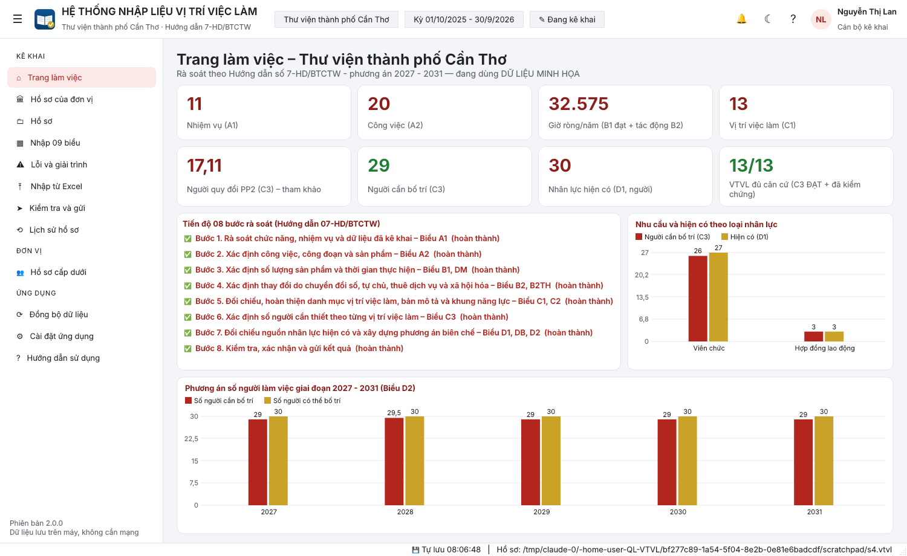
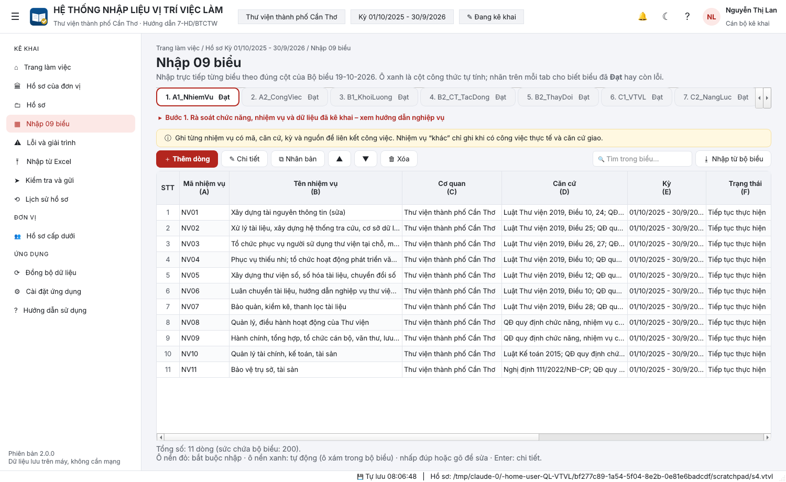
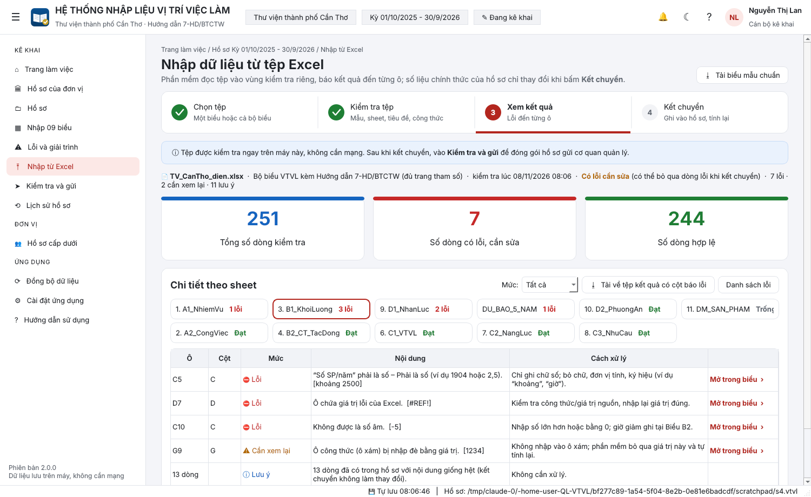
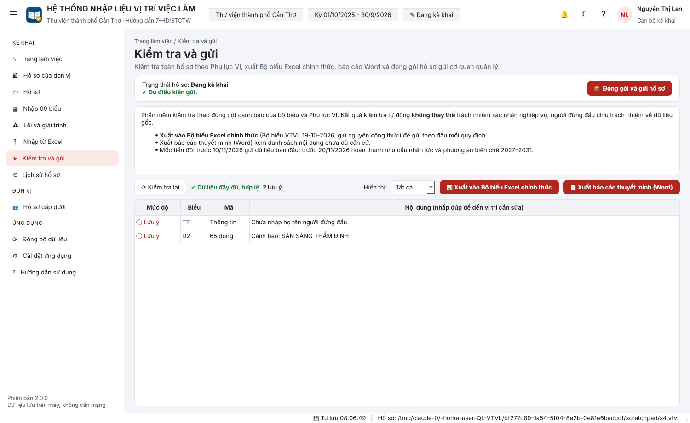

# Hệ thống nhập liệu vị trí việc làm (QL-VTVL)
### Thư viện thành phố Cần Thơ

Phần mềm cài trên Windows để **rà soát, hoàn thiện vị trí việc làm, xác định nhu cầu nhân lực và xây dựng phương án biên chế giai đoạn 2027 – 2031**. Phần mềm làm theo **Hướng dẫn số 7-HD/BTCTW ngày 19/10/2026 của Ban Tổ chức Trung ương** và **Bộ biểu Excel 19-10-2026** kèm theo.

- Dùng đúng tên cột, ký hiệu cột, danh sách chọn, công thức và cảnh báo của Bộ biểu. Kết quả tính đã được đối chiếu với chính Bộ biểu: **0 sai lệch trên 1.857 ô công thức**.
- Chạy độc lập trên máy, không cần mạng.



---

## 1. Cài đặt
Yêu cầu Windows 10/11, 64-bit. Không cần quyền quản trị.

1. Tải **`CaiDat_QL-VTVL_2.0.0.exe`** tại **Actions → Đóng gói bộ cài Windows →** lần chạy mới nhất **→ Artifacts `QL-VTVL-Windows`**, hoặc tại mục **Releases**.
2. Chạy tệp cài đặt. Nếu SmartScreen cảnh báo, chọn *More info → Run anyway*.

Bản `QL-VTVL_portable.zip` không cần cài: giải nén rồi chạy `QL-VTVL.exe`.

## 2. Bố cục và chức năng

**Thanh trên cùng**, từ trái sang phải:
- nút thu gọn/mở rộng thanh bên;
- tên hệ thống;
- chip **đơn vị**, chip **kỳ thống kê** (01/10/2025 – 30/9/2026), chip **trạng thái hồ sơ** (Đang kê khai / Đã gửi · phiên bản);
- **chuông** hiện số lỗi và cảnh báo (bấm để mở *Lỗi và giải trình*);
- nút **sáng/tối**, nút **trợ giúp**;
- người dùng và vai trò.

**Thanh bên** gồm ba nhóm:

| Nhóm | Mục | Chức năng |
|---|---|---|
| **KÊ KHAI** | Trang làm việc | Số liệu tổng hợp, tiến độ 08 bước, biểu đồ nhu cầu – hiện có – phương án |
| | Hồ sơ của đơn vị | Thông tin đơn vị, người ký, kỳ, ngày chốt, mẫu Bộ biểu, quỹ giờ; căn cứ pháp lý |
| | Hồ sơ | Hồ sơ đang mở, hồ sơ gần đây, tạo mới, mở, lưu bản sao, dữ liệu minh họa |
| | Nhập 09 biểu | Nhập trực tiếp A1, A2, B1, B2 (chi tiết, tổng hợp), C1, C2, C3, D1, dự báo, D2, danh mục sản phẩm. Mỗi tab có nhãn **Đạt / n lỗi** và hướng dẫn nghiệp vụ của bước tương ứng |
| | Lỗi và giải trình | Toàn bộ lỗi, cảnh báo; ghi **giải trình** ngay trong bảng; *Mở trong biểu* |
| | Nhập từ Excel | Quy trình 4 bước có **kết chuyển** (mục 3) |
| | Kiểm tra và gửi | Kiểm tra theo Phụ lục VI; xuất Bộ biểu Excel chính thức, báo cáo Word; **đóng gói và gửi hồ sơ** |
| | Lịch sử hồ sơ | Nhật ký tạo, kết chuyển, xuất, gửi, khôi phục; **khôi phục** về một mốc bất kỳ |
| **ĐƠN VỊ** | Hồ sơ cấp dưới | Tổng hợp nhiều hồ sơ (.vtvl hoặc Bộ biểu .xlsx) của đơn vị trực thuộc; xuất bảng tổng hợp |
| **ỨNG DỤNG** | Đồng bộ dữ liệu | Xuất/nhập gói dữ liệu .vtvl giữa các máy; danh sách bản sao lưu, khôi phục |
| | Cài đặt ứng dụng | Sáng/tối, màu nhấn (đỏ, xanh dương, xanh lục), cỡ chữ, người dùng, vai trò, tự sao lưu khi đóng |



## 3. Nhập từ Excel: Chọn tệp → Kiểm tra tệp → Xem kết quả → Kết chuyển
Phần mềm đọc tệp vào **vùng kiểm tra riêng** và báo kết quả đến từng ô. **Số liệu chính thức của hồ sơ chỉ thay đổi khi bấm *Kết chuyển*.**

1. **Chọn tệp:** kéo thả hoặc chọn tệp .xlsx; phạm vi *cả bộ biểu* hoặc *một biểu*. Nút **Tải biểu mẫu chuẩn** lưu Bộ biểu đã sửa các công thức lỗi để phát cho người điền.
2. **Kiểm tra tệp:** kiểm tra mẫu, sheet, tiêu đề cột và công thức.
3. **Xem kết quả:**
   - 3 thẻ số liệu: *Tổng số dòng kiểm tra*, *Số dòng có lỗi, cần sửa*, *Số dòng hợp lệ*;
   - **chi tiết theo sheet**: tab có nhãn *Đạt / n lỗi / Xem lại*, bảng **Ô · Cột · Mức · Nội dung · Cách xử lý · Mở trong biểu**;
   - **Tải về tệp kết quả có cột báo lỗi**: bản sao tệp có thêm cột *KẾT QUẢ KIỂM TRA* ở mỗi sheet, ô lỗi được tô màu và có ghi chú, để gửi lại người điền.
4. **Kết chuyển:**
   - chọn biểu cần kết chuyển; chọn *bổ sung/cập nhật theo mã* hoặc *thay thế*; tùy chọn *bỏ qua dòng lỗi*;
   - phần mềm tự sao lưu trước, ghi vào hồ sơ, tính lại toàn bộ và ghi lịch sử. Có thể **hoàn tác**.

**Những gì được kiểm tra:**
- **Tệp:** sai định dạng, tệp hỏng hoặc có mật khẩu, không phải Bộ biểu.
- **Sheet:** cột bị chèn/xóa/đổi tên thì không nhập sheet đó.
- **Ô:** chữ trong cột số, số âm, ô lỗi Excel, năm ngoài 2027–2031, giá trị ngoài danh sách chọn, ô công thức bị nhập đè, thiếu mã.
- **Liên kết:** trùng mã; **trùng với dòng đã có trong hồ sơ** (báo *Cần xem lại*; nếu giống hệt thì gộp thành một lưu ý); mã chưa có ở biểu gốc; vượt sức chứa.
- **Tự chuẩn hóa:** chữ hoa/thường, Unicode tiếng Việt, ngày tháng, cách viết số kiểu Việt Nam.



## 4. Kiểm tra và gửi hồ sơ
- Kiểm tra theo cột cảnh báo của Bộ biểu và Phụ lục VI. Hồ sơ **đủ điều kiện gửi** khi không còn lỗi và mọi cảnh báo đã có giải trình.
- **Đóng gói và gửi hồ sơ** tạo tệp `.zip` gồm:
  - Bộ biểu Excel chính thức (giữ công thức, đã tự sửa lỗi công thức của bản phát hành);
  - báo cáo thuyết minh Word, có bảng nội dung chưa đủ căn cứ kèm giải trình;
  - danh sách giải trình;
  - tệp hồ sơ `.vtvl`;
  - tệp *ĐỌC TRƯỚC*.

  Phiên bản được đánh số, lưu bản sao và ghi vào Lịch sử hồ sơ. Gửi tệp .zip qua kênh quy định (thư điện tử công vụ, phần mềm quản lý văn bản…).



## 5. Tính toán và lỗi của bản Bộ biểu phát hành
- **B1:** Giờ SP = Số SP × Phút/SP ÷ 60 (ưu tiên phút chuẩn đã xác nhận). Chỉ dòng **ĐẠT** được chuyển sang C3.
- **B2:** Giờ giảm = SP áp dụng × (Phút trước − Phút sau) ÷ 60. Giờ tác động ròng = Giờ việc mới − Giờ giảm hợp lệ.
- **C1/C3:** Người quy đổi PP2 = Giờ ròng ÷ Quỹ giờ (1.904). Ví dụ trong Hướng dẫn: 2.600 ÷ 1.904 ≈ 1,366, không tự làm tròn.
- **D1, dự báo, D2:** theo đúng chuỗi cảnh báo của Bộ biểu.

Khi xuất, phần mềm tự sửa các công thức lỗi của bản 19-10-2026:
- `C3`!M4:M202, `D2`!J4:J202, `DU_BAO_5_NAM`!G, I: trỏ sang tệp ngoài, chuỗi thông báo bị đánh số theo dòng;
- `C1`!E35:E202: gọi tên `QUY_GIO_PP34`… thay vì `QUY_GIO_PP2`.

## 6. Căn cứ
Kết luận 107-KL/TW ngày 17/10/2026; Hướng dẫn 7-HD/BTCTW ngày 19/10/2026 (Phụ lục I–VIII, Bộ biểu, Cẩm nang); Hướng dẫn 06-HD/BTCTW; Nghị định 232/2026/NĐ-CP (viên chức); Nghị định 361/2025/NĐ-CP (công chức); Luật Viên chức 2025; Luật Thư viện 2019; Thông tư 07/2023/TT-BVHTTDL.

## 7. Dành cho cán bộ kỹ thuật
```bash
pip install -r requirements.txt
python run.py                 # chạy từ mã nguồn
python -m pytest tests        # 24 kiểm thử
```
Tự đóng gói trên Windows: chạy `build_windows.bat` (cần Python 3.11+ và Inno Setup 6). Trên GitHub, workflow `build-windows.yml` tự kiểm thử, đóng gói và tạo bộ cài; gắn tag `v2.0.0` để phát hành.

```
qlvtvl/core/   forms (đặc tả biểu) · calc (công thức) · checks (Phụ lục VI) · exporter (Bộ biểu, Word)
               importer (kiểm tra, kết chuyển, tệp kết quả) · package (gửi, giải trình, cấp dưới) · db (hồ sơ, lịch sử)
qlvtvl/ui/     main_window (khung) · import_page · pages2 (các mục chức năng) · pages · form_editor · widgets · theme
```
